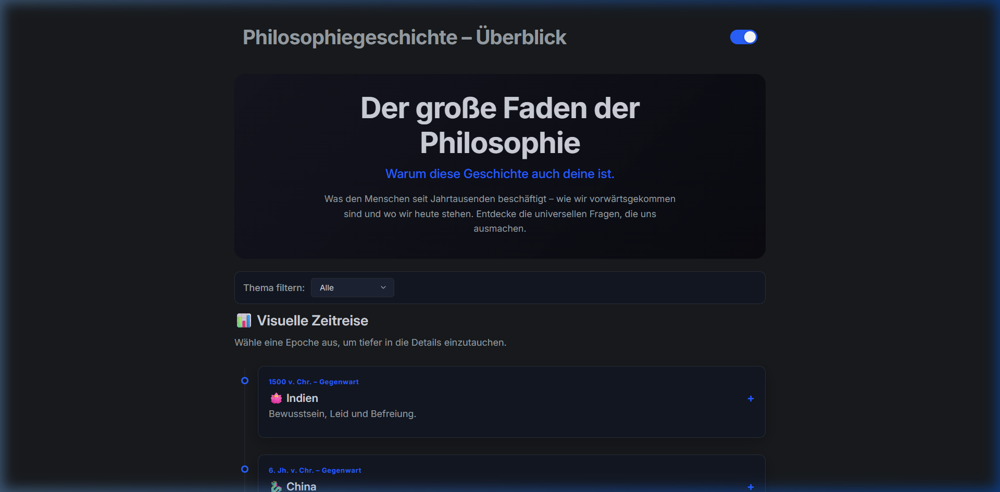

# History of Philosophy (Philosophiegeschichte)

**Version 2.0 – 2026‑10‑21**

*Read this in [German](readme.md).*

[](https://isma1973.github.io/Philosophiegeschichte/)



A fully modular, data-driven learning platform for the global history of philosophy – from the wisdom traditions of Asia to the present day.  
Featuring **81 dynamically rendered philosopher profiles**, 10 era modules, an interactive timeline, Spotlight real-time search, a cross-page favorites system, a Tinder-style swipe discovery gallery, a didactic quiz engine, a dual theme engine (Obsidian Slate Dark Mode & Ivory Light Mode), and an accessible ARIA architecture — **100% offline-ready, zero-build, and formatted in Swiss Standard German (`de-CH`)**.

---

## Features

- **Global Timeline:** 10 historical eras (India, China, Islamic World, Japan, Antiquity, Middle Ages, Early Modern, Modern, 20th Century, Contemporary) structured as accessible, animated accordion panels with era summaries and philosopher badges.
- **Spotlight Real-Time Search (`Ctrl + K` / `/`):** Instant full-text search directly in the topbar across all 81 thinkers (names, eras, fields, theses, and core ideas) with query highlighting, portrait avatars, keyboard navigation (`↑`/`↓`/`Enter`/`Esc`), and inline favorite stars.
- **Favorites & Bookmarking System:** Save thinkers with a single click on profile cards, in the discovery gallery, or directly in search results (`philo_favorites_v1` in `localStorage`), synchronized across all pages via custom DOM events (`philosophy:favorites-changed`).
- **Thematic & Favorites Filtering:** Filter chips for *Ontology*, *Epistemology*, *Ethics*, *Aesthetics*, *Logic*, *Metaphysics*, *Language*, *Power*, *Mind*, *Being*, as well as an interactive *⭐ Saved* chip to filter epochs by bookmarked philosophers.
- **Discover Gallery (`galerie.html`):** Tinder-style swipe cards for intuitive discovery. Controlled via touch gestures, mouse drag, or keyboard (`←` Next, `→` Open profile, `Z` / `↺` Undo), featuring a card counter, haptic vibration, and quick bookmarking.
- **Didactic Quiz Engine:** Two selectable difficulty levels (Easy: 3 questions / Advanced: 7 questions), an animated live progress bar, in-depth contextual explanation boxes after each answer explaining the philosophical background, and rewards (era portrait slideshow & quotes).
- **Random Philosopher (`🎲`):** Dedicated button in the topbar navigation for quick inspiration and serendipitous discovery.
- **Data-Driven Profiles:** All 81 profiles are centrally maintained in `PHILOSOPHERS[]`. Individual HTML profile files act as shell templates that render content dynamically based on URL slug — zero duplicated markup.
- **Interactive Quote Cards:** Prominent thesis display with a one-click clipboard copy button and toast notification.
- **Premium Design & Typography:** Curated Obsidian Slate Dark Mode and Ivory Light Mode with subtle glassmorphism, tailored color palettes, and locally embedded Inter typography.
- **Swiss Standard German (CH-DE):** Typographically consistent following Swiss conventions (no `ß`, consistent `ss`), outward-pointing Swiss guillemets (`«...»`), and `lang="de-CH"`.
- **Zero-Build & Offline-First:** Pure HTML5, modern CSS3, and Vanilla JavaScript (ES6+) — runs immediately by double-clicking `index.html` via `file://` without any web server, Node.js, or bundlers.
- **ARIA-Optimized:** Full accessibility compliance through semantic elements and ARIA attributes across all interactive components.

---

## ⚡ Performance

In verified audits, the platform consistently achieves a perfect **100/100** score across all Google Lighthouse categories:

- 🟢 **Performance:** 100/100
- 🟢 **Accessibility:** 100/100
- 🟢 **Best Practices:** 100/100
- 🟢 **SEO:** 100/100

---

## Getting Started

### Open Directly in Browser

Double-click `index.html` in your file explorer or open it in any modern browser.  
Because all assets (fonts, scripts, images) are bundled locally, the entire application works seamlessly offline via `file://`.

### Keyboard Shortcuts

| Shortcut | Action |
| --- | --- |
| `Ctrl + K` or `/` | Open and focus Spotlight search |
| `↑` / `↓` | Navigate search results |
| `Enter` | Open selected philosopher |
| `Esc` | Close Spotlight search |
| `←` / `→` | Tinder Gallery: Next card / Open profile |
| `Z` or `Backspace` | Tinder Gallery: Undo last card swipe |

---

## Project Structure

```text
Philosophiegeschichte/
├── index.html                   # Homepage (Timeline, Topbar Search & Thematic Filters)
├── galerie.html                 # Tinder-Style Discovery Mode (Swipe Cards)
├── quiz.html                    # Interactive Quiz Module with Educational Feedback
├── philosophen/                 # 10 era overview articles + 81 individual profiles
│   ├── antike.html
│   ├── china.html
│   ├── indien.html
│   ├── islam.html
│   ├── japan.html
│   ├── mittelalter.html
│   ├── neuzeit.html
│   ├── moderne.html
│   ├── 20jh.html
│   ├── gegenwart.html
│   └── [slug].html              # 81 dynamically populated philosopher profile pages
├── assets/
│   ├── css/                     # Modular design system
│   │   ├── core.css             # Global design tokens & CSS reset
│   │   ├── core-theme.css       # Obsidian Slate & Ivory theme variables
│   │   ├── core-ui.css          # Base typography & UI components
│   │   ├── layout.css           # Grid & flexbox layouts
│   │   ├── typography.css       # Local Inter font stack & typography rules
│   │   ├── ui-kit.css           # Reusable UI primitives (buttons, chips, cards)
│   │   ├── custom.css           # Project overrides, sticky topbar, search & hero
│   │   └── components/
│   │       └── timeline.css     # Timeline accordion & era styling
│   ├── fonts/                   # Local Inter font files (WOFF2)
│   ├── img/                     # Optimized .webp portraits & era imagery
│   └── js/                      # Modular Vanilla JS architecture
│       ├── philosopher-profile.js  # Central database (81 profiles) & dynamic renderer
│       ├── quickfinder.js          # Spotlight live search & keyboard navigation
│       ├── favorites.js            # Shared LocalStorage Favorites Manager
│       ├── galerie.js              # Tinder card swipe engine & haptic feedback
│       ├── quiz.js                 # Quiz engine with contextual feedback & progress
│       ├── timeline.js             # Accordion timeline with ARIA integration
│       ├── theme.js                # Dark/Light mode switcher via localStorage
│       ├── lightbox.js             # Image lightbox for portraits
│       ├── modal.js                # Dialog & modal component
│       ├── toast.js                # Toast notification system
│       ├── tooltip.js              # Accessible tooltip component
│       ├── tabs.js                 # Tab navigation module
│       ├── dropdown.js             # Dropdown menu module
│       ├── switches.js             # iOS-style toggle switches
│       └── core-ui.js              # Framework initialization bootstrap
└── docs/                        # Documentation of the Ismail UI Framework
```

---

## Core Modules

### 1. Spotlight Search (`quickfinder.js`)
Real-time search index anchored in the sticky topbar: Scans names, core theses, eras, disciplines, and key ideas across all 81 thinkers on every keystroke. Highlights matching terms with `<mark>`, displays miniature portraits and era badges, and supports full keyboard control (`Ctrl + K`, arrows, `Enter`, `Esc`).

### 2. Favorites Manager (`favorites.js`)
Lightweight local persistence layer utilizing `localStorage` (`philo_favorites_v1`). Emits custom `philosophy:favorites-changed` DOM events to keep profile bookmark buttons, gallery card stars, search results, and timeline badges synchronized in real time without side effects.

### 3. Swipe Discovery Gallery (`galerie.js`)
Designed for mobile and desktop exploratory learning: Delivers fluid card physics with spring dynamics, rotation on drag, swipe history stack for undo (`↺`), keyboard hotkeys, and subtle haptic feedback via `navigator.vibrate`.

### 4. Database & Dynamic Templating (`philosopher-profile.js`)
The central engine: A single database containing all 81 thinkers in the `PHILOSOPHERS[]` array. Each standalone HTML profile page serves as a minimal shell that injects biographies, core thoughts, historical contexts, major works, and quotes dynamically at runtime based on the URL slug.

### 5. Didactic Quiz Engine (`quiz.js`)
Provides era-specific question banks in 3-question or 7-question rounds. After every selected answer, an animated feedback panel provides immediate historical and philosophical rationale. Achieving full marks automatically unlocks era image slideshows or wisdom quotes.

### 6. Theme Engine (`theme.js`)
Switches between Obsidian Slate (Dark Mode) and Ivory (Light Mode) with zero layout shifts or flash of unstyled content. State persists seamlessly across sessions.

---

## Technical Specifications

- **Tech Stack:** 100% Vanilla HTML5, modern CSS3, and ES6+ JavaScript.
- **Zero Dependencies:** No external CDNs, no React, Vue, jQuery, or Tailwind.
- **Offline Guaranteed:** Double-click and run via `file://` — zero server dependencies.
- **Typography:** Swiss Standard German conventions (`de-CH`), outward-pointing guillemets (`«...»`), and consistent `ss` spelling.
- **Accessibility (A11y):** Screen-reader-tested semantics with comprehensive ARIA roles, states, and keyboard management.

---

<details>
<summary><strong>View all 81 philosophers in the overview table</strong></summary>

| Name | Era | Primary Field | Core Thesis |
| --- | --- | --- | --- |
| **Thales of Miletus** | Antiquity | Natural Philosophy | Nature can be explained through natural causes rather than myth. |
| **Heraclitus** | Antiquity | Cosmology, Logos | Everything flows (panta rhei); reality is an ongoing process of change. |
| **Parmenides** | Antiquity | Ontology, Metaphysics | What is, is; real change is an illusion of the senses. |
| **Socrates** | Antiquity | Ethics, Dialectic | The unexamined life is not worth living; moral knowledge requires self-examination. |
| **Plato** | Antiquity | Metaphysics, Epistemology | True reality consists of immutable, eternal Forms beyond the sensory world. |
| **Aristotle** | Antiquity | Logic, Metaphysics, Ethics | Essence and reality are understood through systematic empirical inquiry and four causes. |
| **Epicurus** | Antiquity | Ethics, Atomism | Happiness is achieved through simple living, absence of physical pain, and ataraxia (peace of mind). |
| **Zeno of Citium** | Antiquity | Stoicism, Ethics | Virtue is the sole good; emotional tranquility comes from living in harmony with nature and reason. |
| **Hypatia of Alexandria** | Antiquity | Neoplatonism, Mathematics | The exploration of mathematics and cosmic order leads to divine truth. |
| **Diogenes of Sinope** | Antiquity | Cynicism, Ethics | True freedom lies in extreme self-sufficiency and rejection of arbitrary social conventions. |
| **Pythagoras** | Antiquity | Pre-Socratics, Mathematics | All is number; the cosmos is governed by mathematical and musical harmony. |
| **Marcus Aurelius** | Antiquity | Stoicism, Ethics | The happiness of your life depends upon the quality of your thoughts. |
| **The Vedic Seers (Rishis)** | India | Metaphysics, Cosmology | The Absolute (Brahman) and the innermost self of humanity (Atman) are ultimately one. |
| **Siddhartha Gautama (Buddha)** | India | Ethics, Liberation | Suffering arises from attachment; detachment and mindfulness lead to liberation (Nirvana). |
| **Nagarjuna** | India | Ontology, Madhyamaka | All phenomena are empty (Śūnyatā) of intrinsic, independent existence. |
| **Adi Shankara** | India | Advaita Vedanta | Ultimate reality (Brahman) and the inner self (Atman) are non-dual; plurality is Maya (illusion). |
| **Chanakya (Kautilya)** | India | Political Philosophy | Statecraft and survival of the kingdom supersede conventional moral doctrines. |
| **Sri Aurobindo** | India | Integral Philosophy | Evolution is the progressive spiritual unfolding of divine consciousness into matter. |
| **Rabindranath Tagore** | India | Humanism, Aesthetics | The highest truth is the harmonious realization of humanity's unity with the universe. |
| **Confucius (Kongzi)** | China | Ethics, Social Philosophy | Social order and harmony flourish through moral virtue, ritual propriety (Li), and benevolent roles (Ren). |
| **Laozi** | China | Daoism | Soft water overcomes hard stone. Action through non-forcing (Wu Wei) in harmony with the Dao. |
| **Zhuangzi** | China | Daoism, Epistemology | Human perspectives are relative. Freedom lies in transcending rigid distinctions and concepts. |
| **Mozi** | China | Ethics, Logic | Universal love (Jian'ai): We must care for all individuals equally to maximize welfare. |
| **Mencius (Mengzi)** | China | Ethics, Political Philosophy | Human nature is fundamentally good, flowing towards virtue as water naturally flows downhill. |
| **Zhu Xi** | China | Neo-Confucianism | Reality consists of cosmic organizing principle (Li) combined with vital material energy (Qi). |
| **Dōgen Zenji** | Japan | Zen Buddhism | Zazen (seated meditation) is not a means to enlightenment, but the actual practice of enlightenment itself. |
| **Nishida Kitarō** | Japan | Epistemology, Kyoto School | Pure experience precedes the split into subject and object; ultimate reality is the 'Absolute Nothingness' (Basho). |
| **Watsuji Tetsurō** | Japan | Ethics, Environmental Philosophy | Human existence is inherently relational (betweenness) and intrinsically shaped by climate and space (Fudo). |
| **Al-Farabi** | Islamic World | Logic, Political Philosophy | Philosophy provides universal rational truth, while religion conveys it symbolically for society. |
| **Avicenna (Ibn Sina)** | Islamic World | Metaphysics, Medicine | Rational metaphysics systematizes the distinction between essence and existence and proves God as Necessary Being. |
| **Al-Ghazali** | Islamic World | Theology, Mysticism | Pure rationalism cannot grasp ultimate metaphysical reality; direct truth requires spiritual and mystical insight. |
| **Averroes (Ibn Rushd)** | Islamic World | Philosophy, Law | Philosophical reason and religious revelation do not conflict; both express the same truth in different modes. |
| **Ibn Khaldun** | Islamic World | Philosophy of History, Sociology | The rise and fall of civilizations is driven by the cyclical dynamics of social solidarity (Asabiyya). |
| **Augustine of Hippo** | Middle Ages | Theology, Philosophy of Religion | Divine grace and internal illumination are necessary for truth, healing human free will. |
| **Boethius** | Middle Ages | Scholasticism, Logic | True wisdom unites divine providence with the realization that genuine happiness cannot be lost to fortune. |
| **Thomas Aquinas** | Middle Ages | Scholasticism, Natural Theology | Faith and reason are complementary; natural philosophy and intellect can deduce foundational truths of God. |
| **Meister Eckhart** | Middle Ages | Mysticism, Theology | The soul can achieve divine union by detaching from all concepts, images, and ego. |
| **William of Ockham** | Middle Ages | Nominalism, Logic | Entities must not be multiplied beyond necessity (Ockham's Razor); universals are merely names. |
| **Niccolò Machiavelli** | Early Modern | Political Theory | Political reality must be analyzed pragmatically as it is, rather than as it ideally should be. |
| **Francis Bacon** | Early Modern | Empiricism, Epistemology | Knowledge is power; mastery of nature is achieved through systematic observation and induction. |
| **Michel de Montaigne** | Early Modern | Humanism, Skepticism | «What do I know?» The honest study of human nature begins with the candid examination of oneself. |
| **René Descartes** | Early Modern | Rationalism, Metaphysics | Systematic doubt reveals the foundational bedrock of certainty: Cogito, ergo sum. |
| **Thomas Hobbes** | Early Modern | Political Philosophy | The natural state of humanity is conflict; peace and security require an absolute social covenant. |
| **Baruch Spinoza** | Early Modern | Pantheism, Ethics | God and Nature are one single infinite substance (Deus sive Natura); freedom is understanding necessity. |
| **John Locke** | Early Modern | Empiricism, Political Philosophy | The mind is a blank slate (Tabula rasa); government is legitimate only by consent to protect natural rights. |
| **Gottfried Wilhelm Leibniz** | Early Modern | Metaphysics, Rationalism | Reality consists of indivisible spiritual monads; God established the best of all possible worlds. |
| **Mary Wollstonecraft** | Early Modern | Feminist Philosophy | Women are not naturally inferior to men; apparent shortcomings stem from artificial educational denial. |
| **David Hume** | Early Modern | Empiricism, Skepticism | All knowledge stems from experience; causation is custom and habit rather than a rationally provable link. |
| **Jean-Jacques Rousseau** | Early Modern | Political Philosophy | The social contract restores natural freedom by subordinating individual will to the General Will. |
| **Immanuel Kant** | Modernity | Critical Philosophy, Ethics | We know phenomena shaped by space, time, and categories; duty is governed by the Categorical Imperative. |
| **Johann Gottlieb Fichte** | Modernity | German Idealism | The self-positing Ego (Ich) is the absolute foundation of all consciousness, reality, and moral action. |
| **Friedrich Schelling** | Modernity | Philosophy of Nature | Nature is visible spirit, and spirit is invisible nature; both form an organic, evolving whole. |
| **G. W. F. Hegel** | Modernity | Dialectics, Idealism | Reality is historical and rational; Geist (Spirit) unfolds dialectically towards absolute freedom. |
| **Arthur Schopenhauer** | Modernity | Metaphysics of Will | The world is driven by a blind, irrational Will; aesthetic contemplation and compassion alleviate suffering. |
| **Søren Kierkegaard** | Modernity | Existentialism, Christian Theology | Truth is subjectivity; authentic individual faith requires a passionate leap beyond abstract systems. |
| **John Stuart Mill** | Modernity | Utilitarianism, Liberalism | Actions are right in proportion as they promote the greatest happiness for the greatest number. |
| **Karl Marx** | Modernity | Historical Materialism | Material production relations determine social consciousness; class struggle drives historical transition. |
| **Friedrich Nietzsche** | Modernity | Critique of Morality | God is dead; traditional morality must be overcome through the radical transvaluation of all values. |
| **William James** | Modernity | Pragmatism, Psychology | The truth of an idea is determined by its practical fruits and workable cash value in lived experience. |
| **Edmund Husserl** | 20th Century | Phenomenology | «To the things themselves»: Phenomenology examines how phenomena directly present themselves in consciousness. |
| **Bertrand Russell** | 20th Century | Analytic Philosophy, Logic | Mathematics reduces to logic; philosophical clarity and empirical skepticism resist dogmatism. |
| **Ludwig Wittgenstein** | 20th Century | Philosophy of Language | «Whereof one cannot speak, thereof one must be silent.» The limits of my language mean the limits of my world. |
| **Martin Heidegger** | 20th Century | Fundamental Ontology | Human existence (Dasein) discloses the meaning of Being through time, care, and thrownness. |
| **Max Horkheimer** | 20th Century | Critical Theory | Instrumental reason separates intellect from emancipation, turning enlightenment into domination. |
| **Theodor W. Adorno** | 20th Century | Critical Theory, Aesthetics | «Wrong life cannot be lived rightly.» Critical Theory unmasks cultural industry and commodification. |
| **Jean-Paul Sartre** | 20th Century | Existentialism | Existence precedes essence: Humans are radically free and wholly responsible for who they become. |
| **Hannah Arendt** | 20th Century | Political Philosophy | Political action and speech in public spaces are the vital conditions of human freedom and plurality. |
| **Simone de Beauvoir** | 20th Century | Feminist Existentialism | «One is not born, but rather becomes, a woman.» Gender is an imposed cultural construct. |
| **Albert Camus** | 20th Century | Absurdism | The absurd arises from human longing for meaning in a silent universe; the answer is defiant rebellion. |
| **Karl Popper** | 20th Century | Critical Rationalism | Scientific claims advance by falsification, not verification; defense of the Open Society against dogma. |
| **Thomas Kuhn** | 20th Century | Philosophy of Science | Science does not evolve linearly, but through periodic revolutionary paradigm shifts. |
| **John Rawls** | 20th Century | Political Philosophy | Justice as fairness: Principles that free and rational persons would accept behind a «Veil of Ignorance». |
| **Jürgen Habermas** | 20th Century | Discourse Ethics | Communicative rationality and uncoerced public discourse form the basis for democratic legitimacy. |
| **Michel Foucault** | 20th Century | Power/Knowledge, Discourse | Power is pervasive, productive, and intricately intertwined with institutional knowledge and discipline. |
| **Jacques Derrida** | 20th Century | Deconstruction | «There is no outside-the-text»: Meanings are perpetually deferred, open to destabilizing deconstruction. |
| **Daniel Dennett** | Contemporary | Philosophy of Mind | Consciousness is a functional evolutionary process devoid of cartesian dualism or mysterious essences. |
| **Martha Nussbaum** | Contemporary | Capabilities Approach | Social justice must be evaluated by real freedoms and substantive capabilities to lead a dignified human life. |
| **Peter Singer** | Contemporary | Practical Ethics, Utilitarianism | Sentience and capacity for suffering ground moral consideration; advocacy for animal liberation. |
| **Judith Butler** | Contemporary | Gender Studies, Queer Theory | Gender is performative: An ongoing set of repeated social practices rather than an innate biological essence. |
| **Slavoj Žižek** | Contemporary | Psychoanalysis, Cultural Critique | Ideology functions in what we do rather than what we believe: We know the fiction, yet we still act on it. |
| **Byung-Chul Han** | Contemporary | Cultural Philosophy | The late-modern achievement society produces toxic self-exploitation, burnout, and isolation. |

</details>

---

## Image Credits

All philosopher portrait artworks on this platform were generated using artificial intelligence (Google Gemini 3.1 Pro / Antigravity) in a consistent vector portrait aesthetic.

Because these artworks were generated entirely by AI, under current international copyright frameworks (EU/US) they are free of human copyright restrictions and are de facto in the **Public Domain**. You are welcome to freely reuse, adapt, and distribute them.

---

## Project License

This project is open-source under the [MIT License](LICENSE). You are free to use, modify, and distribute it.
